<p align="center"></p>

<h1 align="center">Find your kind of elsewhere.</h1>

<p align="center">A considered accommodation discovery and booking experience.<br />Designed as a travel journal. Engineered as a complete Angular application.</p>

<p align="center"><strong>Angular 22 · TypeScript 6 · Signals · Custom CSS · Vitest · Playwright</strong></p>

Oriva is a frontend portfolio project for travelers who care as much about the character of a place as its amenities. Discover boutique hotels, quiet villas, riads, and ryokans; build a shortlist; compare dates and rooms; and complete a transparent simulated reservation.

**Demo scope:** properties, reviews, rates, and inventory are fictional. Reservations are stored in your browser. No real hotel is booked, no payment is taken, and no payment-card information is requested.

[Design system](docs/DESIGN_SYSTEM.md) · [Asset credits](docs/ASSETS.md) · [Validation](docs/VALIDATION.md) · [Getting started](#getting-started) · [Architecture](#architecture-and-engineering-decisions)

## A brand for the moment you arrive

**Oriva** is an invented name inspired by horizons and arrival: the moment a place becomes a feeling. The identity speaks to independent travelers looking for meaningful surroundings and a slower pace. It is warm, observant, and quietly confident. The original compass/sun mark combines a sense of direction with the warmth of a new day. Trademark availability has not been verified or claimed.

Three creative directions were explored before implementation: a slow travel journal, an architectural atlas, and a Mediterranean atelier. The travel journal was selected because it supports both expressive discovery and clear booking decisions. The comparison is documented in the [design system](docs/DESIGN_SYSTEM.md#brand-and-creative-direction).

## Design philosophy

An ivory canvas, forest-green type, and citron accents give photography room to breathe. Fraunces introduces a literary voice; DM Sans keeps forms and prices immediately readable. Both fonts are self-hosted as WOFF2 with their open-source licenses included.

The homepage uses an immersive photographic opening, a practical search interface, curated stays, destination discovery, and an editorial invitation to travel more slowly. Fine rules, asymmetric image compositions, and restrained corners carry the same identity into search and checkout. Booking information has a conventional hierarchy so the visual character never obscures dates, capacity, or cost.

Responsive layouts deliberately rearrange content for narrow screens. Visible keyboard focus, semantic controls, labeled fields, native date inputs and dialogs, polite live feedback, and reduced-motion support are part of the component system. Accessibility is an engineering objective; this project does not claim an independent WCAG certification or an unmeasured Lighthouse score.

## The design system

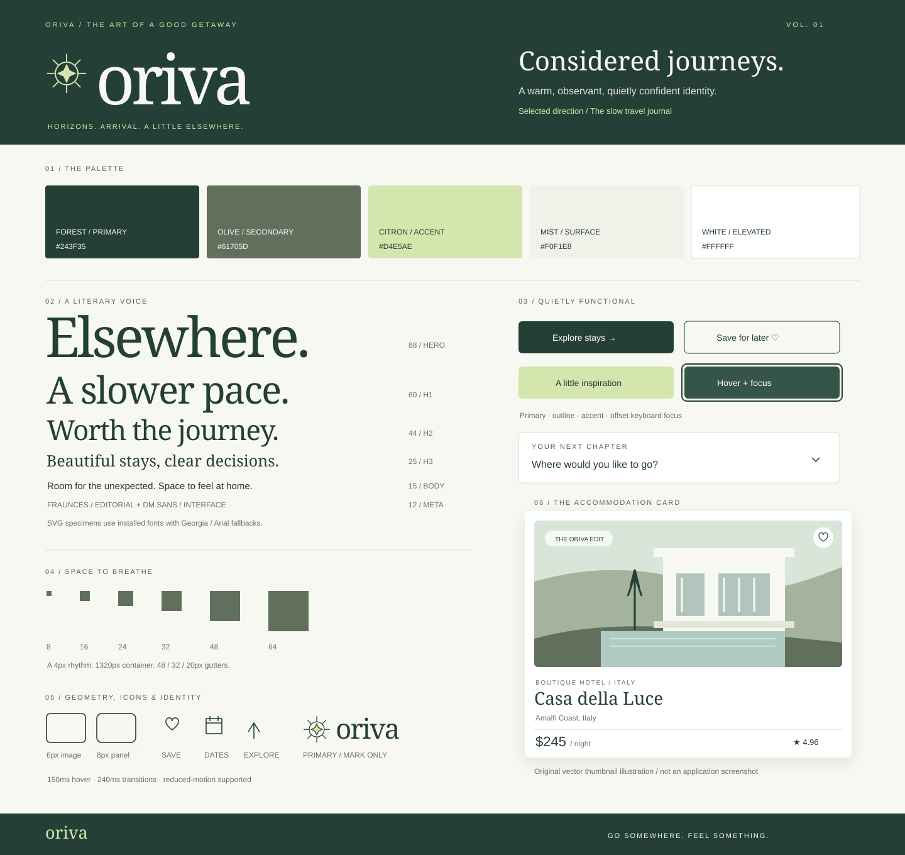

| Foundation | Implementation                                                                               |
| ---------- | -------------------------------------------------------------------------------------------- |
| Color      | Forest `#243F35`, olive `#61705D`, citron `#D4E5AE`, ivory `#F8F8F3`                         |
| Typography | Fraunces for editorial headings; DM Sans for navigation, forms, and body copy                |
| Spacing    | A consistent 4px-based scale, generous section spacing, and a 1320px content limit           |
| Components | Shared search, property card, icon, navigation, form, pricing, dialog, and feedback patterns |
| Motion     | 150–500ms purposeful transitions; reduced-motion preferences respected                       |

The full [design system specification](docs/DESIGN_SYSTEM.md) records semantic tokens, typography, layout, component behavior, accessibility decisions, motion, and the implementation acceptance plan. Styling uses hand-written CSS; no Tailwind, Bootstrap, Angular Material theme, or UI template is used.

## Inside Oriva

The following captures come from the actual running Angular application.

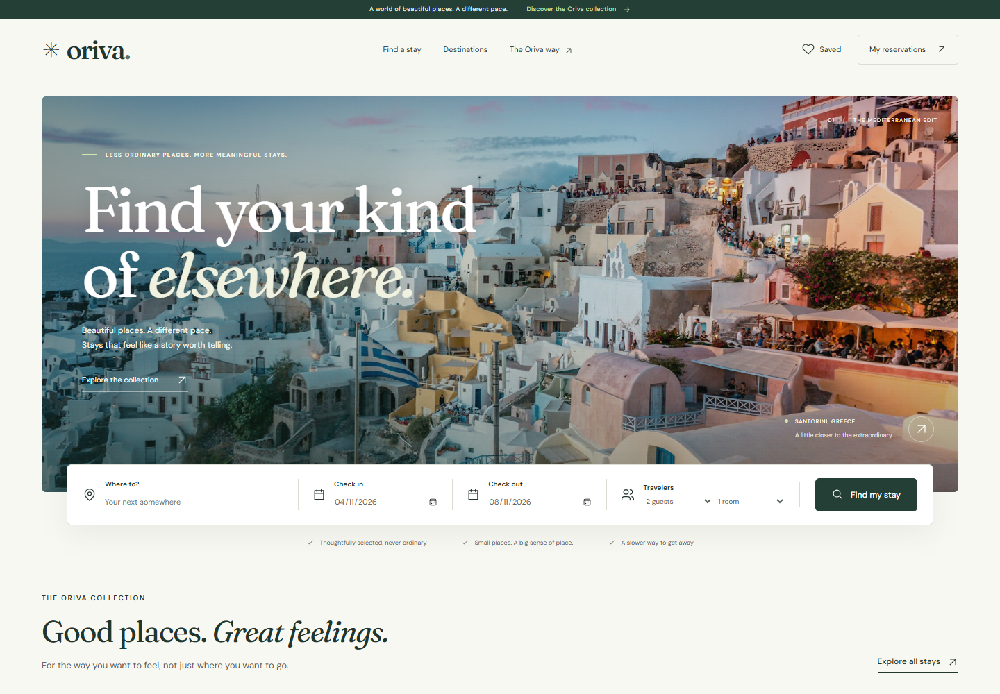

<details>
  <summary>View the complete desktop homepage</summary>

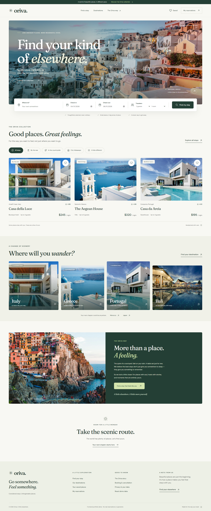

</details>

<table>
  <tr>
    <td width="50%">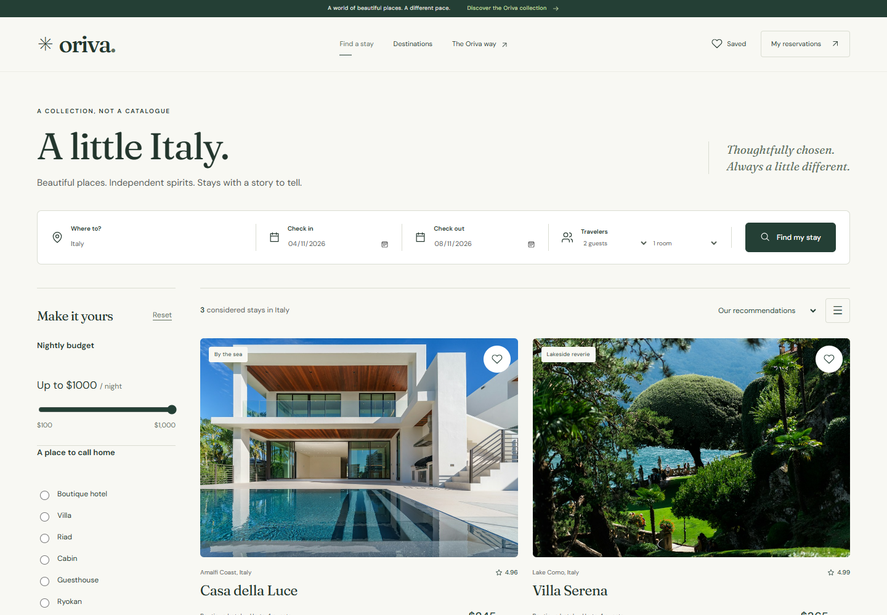<br /><strong>Discover a stay.</strong> Refine dates, amenities, capacity, and price.</td>
    <td width="50%">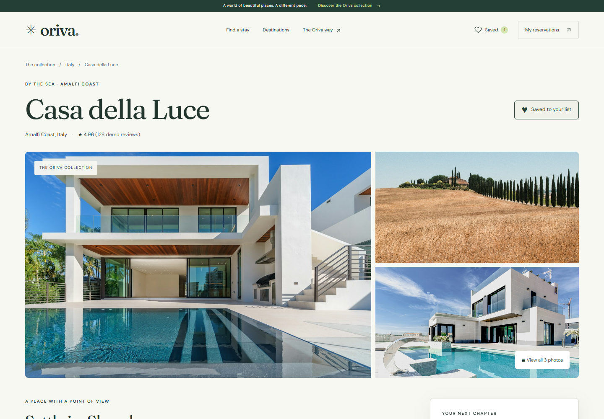<br /><strong>Consider the details.</strong> Explore rooms, character, and policies.</td>
  </tr>
  <tr>
    <td>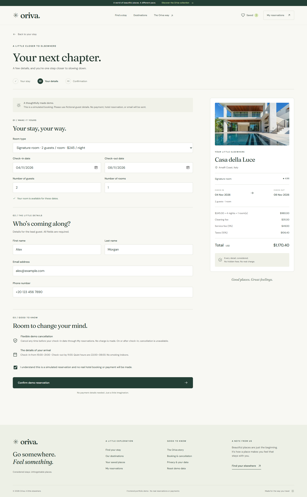<br /><strong>Make a plan.</strong> Review dates and a transparent price breakdown.</td>
    <td>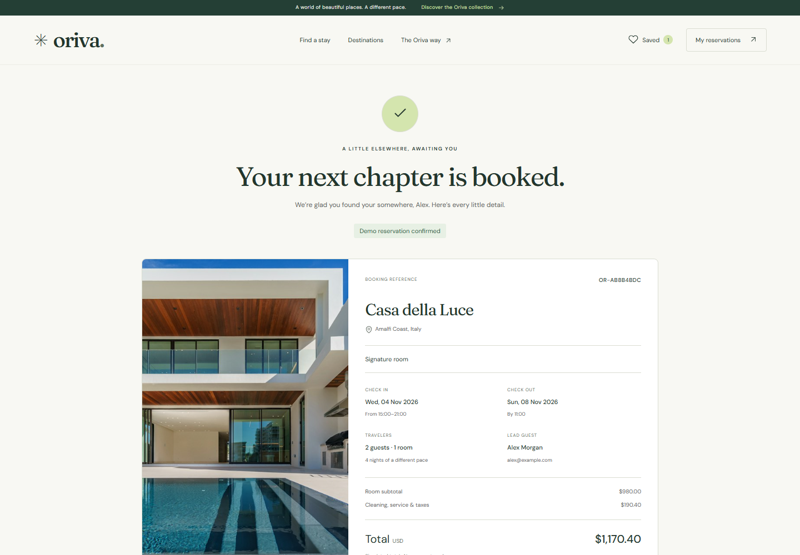<br /><strong>Your next chapter.</strong> A clearly labeled demo confirmation.</td>
  </tr>
  <tr>
    <td>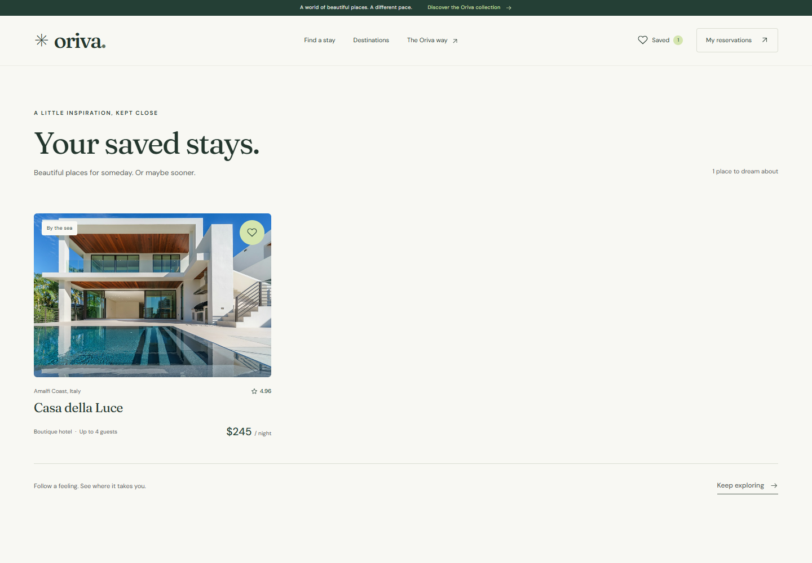<br /><strong>Keep the inspiration.</strong> A shortlist that survives refresh.</td>
    <td>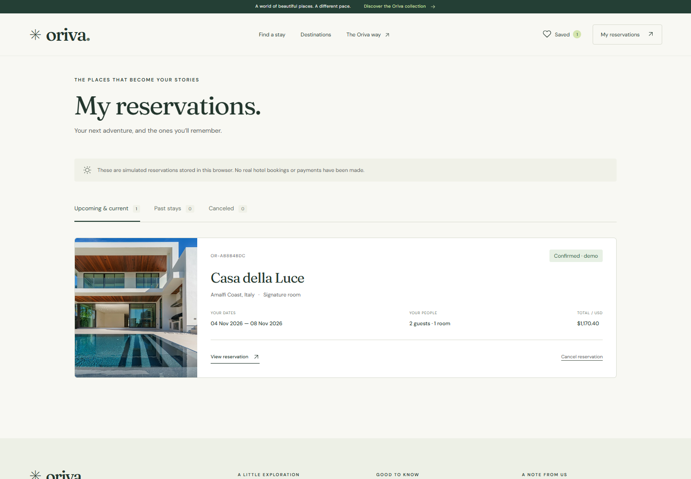<br /><strong>Manage the journey.</strong> View and cancel local demo reservations.</td>
  </tr>
</table>

<details>
  <summary><strong>The mobile experience</strong> — a deliberately rearranged layout at 390px</summary>
  <p>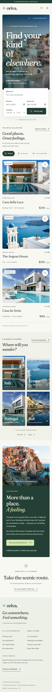</p>
</details>

## The experience

**Discover.** Search by destination, dates, guests, and rooms. Refine real demo results with price, property type, amenities, and rating, then sort by price or rating. Search state lives in URL parameters so a result view can be refreshed or bookmarked. Active filters and helpful empty states make constraints understandable.

**Consider.** Open an accommodation to explore its gallery, room choices, amenities, host information, policies, and pricing. Save individual stays to a persistent shortlist and return whenever inspiration becomes a plan.

**Reserve.** Choose valid dates and sufficient room capacity, review availability and a line-by-line USD price, then enter guest details in a typed reactive form. Clearly labeled demo checkout creates a local confirmation with a reference, total, and printable receipt. No card fields or external payment service are involved.

**Manage.** Reservations remain available after reload and can be filtered into upcoming, past, and canceled states. Eligible future reservations can be canceled after confirmation; canceled inventory is immediately available again. Reset demo data from the application footer when starting a new walkthrough.

## Architecture and engineering decisions

Angular was selected to demonstrate a complete application with explicit domain contracts, dependency injection, routing, and typed forms. Standalone components and lazy feature routes keep composition clear and separate page-level code. Signals hold the small, synchronous application state without adding a state-management dependency.

```text
src/
├── app/
│   ├── core/
│   │   ├── models.ts                  # Accommodation, room, booking, and search contracts
│   │   ├── accommodation.repository.ts # Replaceable data-access boundary
│   │   ├── booking-rules.ts           # Pure filtering, date, inventory, and money rules
│   │   ├── demo-storage.ts            # Versioned storage and safe runtime validation
│   │   └── stay-store.service.ts      # Signal state and booking commands
│   ├── features/
│   │   ├── home/
│   │   ├── search/
│   │   ├── accommodation/
│   │   ├── booking/
│   │   ├── wishlist/
│   │   └── reservations/
│   ├── layouts/                       # Focused header and footer components
│   ├── shared/components/
│   ├── shared/pipes/calendar-date.pipe.ts # Timezone-independent booking date presentation
│   ├── app.config.ts
│   └── app.routes.ts
├── styles/tokens.css
└── styles.css
public/assets/                          # Local imagery, original logo, licensed fonts
docs/                                   # Design decisions, credits, and real captures
tests/                                  # Domain and browser journey verification
```

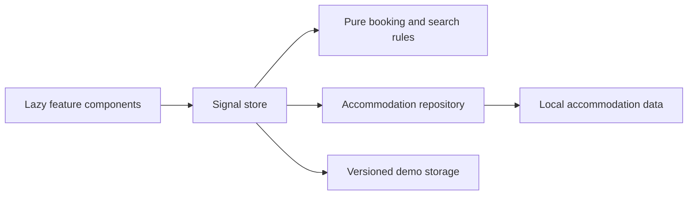

The repository is the data-access boundary for a future REST adapter. Business rules live outside templates and remain testable without rendering the application. The present repository uses local demo data; no HTTP request is added merely to imitate an API.

### Booking invariants

- Dates are strict calendar strings in `YYYY-MM-DD` format. UTC arithmetic counts nights without daylight-saving shifts; the visitor's local date establishes the earliest check-in.
- Calendar dates are formatted from explicit UTC timestamps, preventing date-only strings from appearing one day earlier in timezones such as Africa/Cairo. The browser journey asserts the displayed dates in Cairo.
- Check-out must follow check-in, past check-ins are rejected, and a demo stay is limited to 30 nights.
- Capacity applies to the selected room type multiplied by rooms. Every room must have at least one guest; counts must be positive integers.
- Reservations occupy the half-open interval **[check-in, check-out)**. One guest can check out on the day another checks in. Availability sweeps booking start/end events to measure peak concurrent occupancy, rather than incorrectly adding every overlapping reservation together.
- Only confirmed reservations consume inventory. Cancellation is allowed until the day before check-in.
- USD amounts remain integer cents. Nightly subtotal equals rate × nights × rooms. Cleaning is $35 per room, service is 5% of subtotal, and demo tax is 10% of subtotal plus cleaning and service. Each percentage line is rounded once, then totals are summed.
- Submission validates the room, dates, capacity, availability, and guest details again. Duplicate confirmation requests are handled by the store.

### Persistence and its boundary

Wishlist and reservations use a versioned browser-storage envelope with safe parsing and runtime shape validation. Unavailable or corrupted storage does not crash the interface; state can remain in memory for the current visit. Guest details are local demo data, so use fictional information for portfolio walkthroughs.

Storage is neither authentication nor a transaction system. Another tab can still race a booking, browser data can be edited or cleared, and devices do not synchronize. A real backend must become authoritative for inventory, prices, access control, validation, and booking creation. Replacing the repository alone does not turn the demo booking store into a secure production reservation system.

## Technologies and tools

| Technology                      | Purpose                                                                      |
| ------------------------------- | ---------------------------------------------------------------------------- |
| Angular 22.2.3                  | Standalone components, Router, dependency injection, Signals, reactive forms |
| TypeScript 6.0                  | Strict domain contracts and template checking                                |
| Semantic HTML and custom CSS    | Accessible controls, responsive Grid/Flexbox, shared design tokens           |
| Vitest                          | Focused tests for business rules and persistence behavior                    |
| Playwright                      | Browser journey verification and real application screenshots                |
| Prettier                        | Consistent source, template, style, test, and documentation formatting       |
| Local storage                   | Browser-local demo wishlist and reservations                                 |
| SVG and local WOFF2/JPEG assets | Original identity, sharp design board, predictable asset loading             |

## Getting started

Install a compatible Node.js version: **22.22.3+, 24.15.0+, or 26+**, following the ranges in `package.json`. Node 24 is a suitable choice. npm is included with Node. The committed lockfile pins the dependency graph.

Clone this repository using its GitHub **Code** menu, open a terminal in the checkout, and run:

```sh
npm ci
npm start
```

Open **http://127.0.0.1:4200**. There is no backend, environment file, API key, paid service, or account requirement. Accommodation images and fonts are included locally.

```sh
npm test                 # Run the domain and state test suite once
npm run test:watch       # Watch unit tests during development
npm run build           # Create the optimized Angular production build
npm run format:check    # Verify consistent source formatting
```

For browser verification, the configuration detects installed Microsoft Edge or Google Chrome on Windows. On other systems, install Playwright Chromium once:

```sh
npx playwright install chromium
npm run test:e2e
npm run screenshots
```

If your checkout path contains an ampersand on Windows, use `node ./node_modules/@playwright/test/cli.js install chromium` for that one-time installation command. The npm scripts already invoke tools through Node to support paths containing shell metacharacters. Set `PLAYWRIGHT_EXECUTABLE_PATH` to use another compatible browser executable.

The browser suite exercises a complete discovery-to-reservation journey and invalid booking behavior; screenshot output belongs under `docs/assets/screenshots/`. The commands and automation configuration are the source of truth for local verification. Production static hosting must serve `index.html` for application routes such as `/explore` and `/stays/casa-della-luce`.

## Verification

Verified locally on 21 October 2026 using Node 24.21.0 and Microsoft Edge (Chromium):

- **25 unit tests pass**, covering dates and timezone presentation, inventory sweeps, room-specific budget filtering, pricing, guest validation, booking commands, cancellation, wishlist, storage recovery, and repository retry.
- **5 browser tests pass**, including the complete booking and cancellation journey, invalid submissions, URL filters/sorting/pagination, mobile keyboard/navigation, and tablet layouts.
- Production compilation and strict Angular template checks pass without warnings. Every feature page is a lazy route.
- Real screenshots are captured by the browser suite. Desktop (1440px), mobile (390px), and tablet (768px) layouts were checked for horizontal overflow; key screens were visually inspected.

See [the validation record](docs/VALIDATION.md) for commands, coverage, and verification limits. No Lighthouse score or independent accessibility certification is claimed.

## Demo scope and limitations

- Properties, room inventory, guest reviews, host profiles, rates, fees, and taxes are fictional and illustrative.
- Photography is licensed illustrative imagery, not a representation of the fictional accommodation. Sources and redistribution notices are in [ASSETS.md](docs/ASSETS.md).
- Confirmations reserve local demo inventory only. No hotel, email, payment provider, or external booking platform is contacted.
- Bookings and saved stays are specific to one browser profile. Clearing browser storage removes them; there is no account, cloud synchronization, or server-side protection.
- Frontend validation improves the demo experience but is not a security boundary. Concurrent real-world inventory requires atomic backend enforcement.
- No deployment URL, performance score, accessibility certification, or completed check is claimed without a measured result.

## Next steps

A future ASP.NET Core Web API and SQL Server integration could provide authenticated user data, authoritative inventory, transactional reservations, and server-calculated totals. Real payment-provider integration, booking notifications, and host management would follow that backend foundation rather than being simulated as completed features.

Oriva demonstrates the full path from naming and visual systems to Angular architecture, domain validation, browser-local persistence, responsive interaction design, and verifiable delivery.
